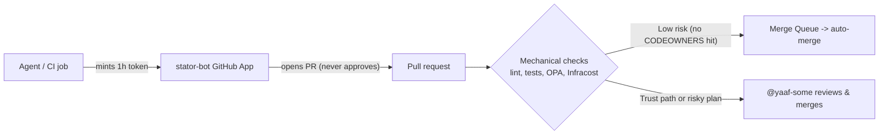

# Bot identity (`stator-bot`)

Using a personal GitHub token for agents breaks separation of duties: GitHub sees the bot's PRs as yours, so `CODEOWNERS` cannot require your review and org PAT scopes cause constant 403 errors. A dedicated GitHub App (`stator-bot`) fixes both in two minutes.

## How it works



## 1. Create the GitHub App (2 minutes, once)
In GitHub, open **Organization settings (`stator-labs`) -> Developer settings -> GitHub Apps -> New GitHub App**:

| Setting | Value | Why |
|---|---|---|
| **App name** | `stator-bot` (or `stator-labs-bot`) | Shows as `stator-bot[bot]` on PRs and commits |
| **Homepage URL** | `https://github.com/stator-labs/stator` | Required by GitHub |
| **Webhook -> Active** | **Unchecked** | No webhook server needed |
| **Where can this app be installed?** | **Only on this account** (`stator-labs`) | Locks it to your org |

### Repository permissions (least privilege)
Leave every other permission at **No access**.

| Permission | Access | Why |
|---|---|---|
| **Contents** | Read and write | Push branches and commits |
| **Pull requests** | Read and write | Open PRs and enable auto-merge |
| **Metadata** | Read-only | Mandatory default |
| **Workflows** | **No access** | Bot cannot rewrite `.github/workflows/` on its own |
| **Administration / Environments** | **No access** | Bot cannot touch rulesets or `aws-apply` |

After clicking **Create GitHub App**:
1. Note the **App ID** (numeric) and **Client ID**.
2. Click **Generate a private key** (downloads a `.pem` file; keep it outside the repo, never commit it).
3. Open **Install App** -> install on **`stator-labs/stator` only** (not all org repos). Note the **Installation ID** from the URL (`.../installations/<ID>`).

## 2. Wire it into GitHub Actions (CI)
Store two items in `stator-labs/stator` **Settings -> Secrets and variables -> Actions**:
- Variable: `STATOR_BOT_APP_ID` = `<App ID>`
- Secret: `STATOR_BOT_PRIVATE_KEY` = contents of the `.pem` file

Any workflow that opens PRs mints a 1-hour token with `actions/create-github-app-token` (pin by commit SHA):

```yaml
- id: bot-token
  uses: actions/create-github-app-token@<pinned-sha>
  with:
    app-id: ${{ vars.STATOR_BOT_APP_ID }}
    private-key: ${{ secrets.STATOR_BOT_PRIVATE_KEY }}
```

## 3. Mint a 1-hour token locally (replaces personal PATs)
Store the `.pem` key at `~/.config/stator/stator-bot.pem` (`chmod 600`) and export a 1-hour `GH_TOKEN` for `gh` and `git`:

```bash
# Minimal helper (requires openssl, curl, jq)
# 1. Sign a 10-minute RS256 JWT with APP_ID + ~/.config/stator/stator-bot.pem
# 2. POST /app/installations/$INSTALLATION_ID/access_tokens -> 1-hour ghs_... token
# 3. export GH_TOKEN="<token>"
```

Once `STAT-46` ships `tools/bot-token.py` (stdlib + `openssl`), one command refreshes a 1-hour `GH_TOKEN` with zero long-lived PATs on disk.

## 4. Enable real `CODEOWNERS` + Merge Queue on `main`
In `stator-labs/stator` **Settings -> Rules -> Rulesets (`main`)**:
1. Turn on **Require a pull request before merging** -> **Require review from Code Owners** (1 approval).
2. Turn on **Require merge queue** (free in the `stator-labs` org; workflows already listen on `merge_group`).
3. Keep `Docs: lint`, `Infrastructure: required checks`, `Policy: trust paths` and `Workflows: lint` required.

**Result:** `stator-bot[bot]` pushes branches and opens PRs. Safe PRs outside [CODEOWNERS](../.github/CODEOWNERS) pass CI and auto-merge through the Merge Queue. Trust-path PRs (`.github/`, `.agents/`, `platform/`, `labs/*/infra/`, `AGENTS.md`) require `@yaaf-some`'s approval, and `stator-bot[bot]` can never approve its own PR.
