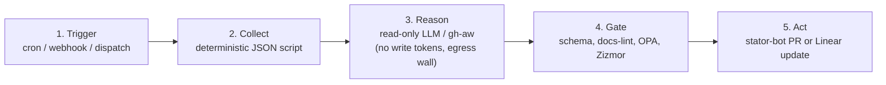

# How this project runs

## Where things live
| What | Where | Lifetime |
|---|---|---|
| Canonical specs, glossary and active proposals | `specs/` (`INDEX.md`, `GLOSSARY.md`, `changes/`) | living truth; deltas deleted on merge |
| Lab knowledge (proof, cost, decisions, what broke) | `labs/NN-*/README.md` | while the lab exists |
| Cross-lab docs | `docs/`, max 8 files ([index](index.md)) | replaced, never appended |
| Active work items, priorities and handoffs | Linear: `yaaf-some` / team `Stator` (`STAT`) linking to Git specs | closes with the issue |
| Architecture baseline and roadmap | Linear `Process` (`P-STAT-1`): `Control center` and `Roadmap` docs | kept current |
| Change review | PR description and comments | closes with the PR |
| Agent rules, skills and hooks | `AGENTS.md` and `.agents/` | kept current |

## Operating loop (General and squads)
Yaaf leads strategy as the General; squads handle tactical execution via four skills in `.agents/skills/`:
1. **Design (`stator-elephant`):** interviews the General and drafts `specs/changes/<slug>/` (`proposal.md` + `tasks.md`) with zero implementation code.
2. **Gate (`stator-goldfish`):** runs a stateless, zero-context cold-eyes review (1 lens for clarity/gaps, 2nd lens for infra/trust/cost) until `PASS`.
3. **Execute (`stator-execute`):** runs each atomic task in a fresh context bounded by its Context Manifest (well inside 200k tokens) with atomic commits.
4. **Sync (`stator-living-docs`):** merges deltas into canonical `specs/`, deletes `specs/changes/<slug>/`, runs all linters, and opens one PR.

## Automation loop (deterministic + bounded AI)
Scheduled and event-driven runs separate state collection from LLM reasoning so untrusted web/issue text never touches write credentials:

- **Board and repo health:** deterministic script checks open PRs, CI failures, `tools/docs-lint.py` and stale `STAT` issues (no LLM).
- **Weekly radar:** deterministic collector + bounded LLM step proposes a PR for [radar](radar.md) and `Idea` issues.
- **Launch digests** (next: Dec 5 re:Invent, `STAT-16`): feed collector + bounded synthesis mapped to Stator labs.

## The board (Linear)
- **Now** (max 2): In Progress · **Next**: Todo · **Later**: Backlog · **Ideas**: Backlog + `Idea` label.
- `Role` labels (`SA`, `Platform`, `Cloud`, `SRE`, `Security`, `AI Infra`, `Defense`) mark what each issue proves. `Process` marks meta work.
- New trends become `Idea` issues and a row in [radar](radar.md), never a plan rewrite.

## Real AWS without surprise bills
- Budgets at $5 / $15 / $30, Cost Anomaly Detection, and an automatic $30 labs kill-switch SCP in `platform/infra/foundation`.
- Mandatory tags (`project`, `lab`, `ephemeral`) enforced by Checkov.
- Nightly reaper lists ephemeral resources (`reaper.yml`); `make nuke` arrives with Lab 03.
- Agents write OpenTofu; GitHub Actions plans on PRs and applies after merge ([platform/infra](../platform/infra/README.md)). Only `bootstrap/` and `foundation/` run from Yaaf's terminal.

## Reading anywhere & writing a lab
- Read on GitHub web/mobile or open the repo as an Obsidian vault (`git pull` syncs it).
- To start a lab, copy `templates/lab-README.md`. Lead with proof, include a cost receipt, and keep decisions as 2–3 sentence "Why not X?" notes.
