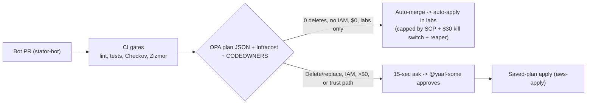

# Human in the loop

Machines clear low-risk work. Yaaf judges real risk: cost, blast radius, trust and irreversible changes.

If an approval takes more than 15 seconds to judge, the ask is too noisy. Rules live in [AGENTS.md](../AGENTS.md#human-in-the-loop); short ask format lives in [stator-presenting](../.agents/skills/stator-presenting/SKILL.md).

## Two-lane flow (target state: `STAT-34`, `STAT-36`, `STAT-46`)

## Principles
1. **Gate by consequence, not file path or effort.** A 5-line IAM edit needs a human; a zero-change cleanup or doc fix should not.
2. **Enforce in tools, not prompts.** Rules live in GitHub rulesets, IAM/SCPs, OPA plan checks and `.agents/hooks.json`.
3. **Manage by exception.** Auto-merge and auto-apply safe, mechanically verified changes in the SCP-capped labs account. Interrupt Yaaf only when a policy flags real risk.
4. **One approval, one exact change.** A yes covers one plan or commit, never the next one. Silence means no.

## Enforcement map
| Gate | Covers | Where | State |
|---|---|---|---|
| `aws-apply` approval | Manual-lane AWS applies: one saved plan, checked by SHA-256, gated again after approval. Auto-lane plans use `aws-apply-auto` (no reviewer, `main` only) | GitHub environments trusted by `stator-ci-apply` | live |
| `main` ruleset | No direct pushes; `Docs: lint`, `Infrastructure: required checks`, `Policy: trust paths`, `Workflows: lint` | GitHub ruleset | live |
| `Policy: trust paths` | Blocks auto-merge outside the allow-list | `policy.yml` (`pull_request_target` on `main`, reads filenames only). An Actions event policy allows that trigger for this file only (`.github/actions-policies/`) | live |
| `Workflows: lint` | Unpinned actions, injection, over-broad perms, shell errors (zizmor + actionlint) | `workflows.yml` | live |
| Dependabot | SHA-pinned action bumps, 7-day cooldown | `.github/dependabot.yml` | live |
| Agent hook guardrails | Denies PR merge/review and reading secrets (`.env`, `*.key`, `*.auto.tfvars`); asks before `aws`, `tofu apply/destroy`, force push | `.agents/hooks.json` + `.agents/hooks/guardrails.py` | live |
| Style & ID linters | Stock phrases, em dashes, leaked AWS account IDs/keys | `tools/docs-lint.py`, `tools/identifier-check.py` | live |
| IAM boundary & SCPs | Caps CI roles and blocks costly/out-of-region labs spend | `platform/infra/bootstrap`, `platform/infra/foundation` | live |
| Budgets & $30 kill switch | Spend alerts + automatic deny-new-spend SCP on labs OU | `platform/infra/foundation` | live |
| Bot identity (`stator-bot`) | Separates bot PRs from Yaaf so `CODEOWNERS` and Merge Queue work natively ([guide](bot-identity.md)) | `STAT-35` / `STAT-46` | planned |
| OPA plan gate + Infracost | Auto-passes $0, non-destructive, non-IAM labs plans; routes risky plans to Yaaf | `STAT-34` | planned |

## Sources
- Anthropic, [safe and trustworthy agents](https://www.anthropic.com/news/our-framework-for-developing-safe-and-trustworthy-agents)
- OWASP, [Top 10 for Agentic Applications](https://genai.owasp.org/2025/12/09/owasp-top-10-for-agentic-applications-the-benchmark-for-agent)
- Approval fatigue & gate placement: [Tian Pan](https://tianpan.co/blog/2026/04/17/hitl-placement-theory-approval-gates), [undrained approval queues](https://tianpan.co/blog/2026/05/17/approval-queue-nobody-drains), [OPA Terraform guide](https://openpolicyagent.org/docs/terraform), [Infracost](https://www.infracost.io/docs/integrations/github_actions/)
