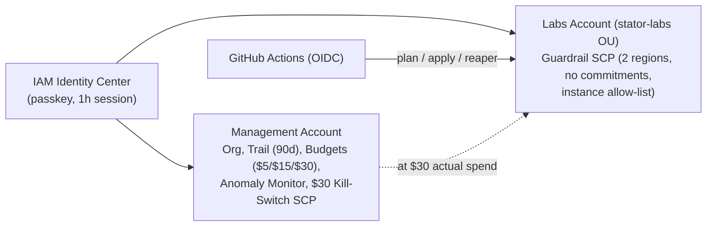

# Lab 00 · Account Foundation

## Proof
- **PR plan comment:** [PR #13](https://github.com/yaaf-some/cloud-project/pull/13#issuecomment-7017659792) (`2 to add, 0 to change, 0 to destroy`).
- **Approved OIDC apply:** [run 44585735716](https://github.com/yaaf-some/cloud-project/actions/runs/44585735716) waited 12 min on `aws-apply` for Yaaf, then signed in as `runway-apply` via OIDC (`2 added`).
- **Budgets & kill switch:** budgets created in [PR #9 run](https://github.com/yaaf-some/cloud-project/actions/runs/44581039403/attempts/1), migrated to [platform/infra/foundation](../../platform/infra/foundation/) in PR #18 ([run 44944710382](https://github.com/stator-labs/stator/actions/runs/44944710382), 0 destroyed), and applied by Yaaf on 2026-11-21: `make plan` shows zero drift, `runway-labs-kill-switch` is `STANDBY`, SCP targets `[]`, MTD spend `$0.046`.
- **Nightly reaper (dry run):** created in [run 44703993484](https://github.com/yaaf-some/cloud-project/actions/runs/44703993484); first OIDC dry run passed in [run 44704490487](https://github.com/yaaf-some/cloud-project/actions/runs/44704490487).
- **Org guardrails (2026-11-20):** `foundation/` applied (`1 imported, 24 added, 1 changed, 0 destroyed`). In labs, `ec2 describe-instances` succeeded in `us-west-2` and failed with `explicit deny in a service control policy` in `eu-west-1` and on `RoleManager/Enabled=true`.
- **Free account hardening (2026-11-27):** PR #36 merged, Yaaf approved `aws-apply`, and [run 46028414977](https://github.com/stator-labs/stator/actions/runs/46028414977) applied `11 added, 0 changed, 0 destroyed`: EBS encryption by default, snapshot, AMI and SSM document public-sharing blocks, IMDSv2 defaults (us-east-1 and us-west-2) and the account S3 public access block.
- **Mocked OpenTofu tests (no AWS creds):** `tofu test` passes [3 Lab 00 tests](infra/tests/account-foundation.tftest.hcl) and [20 foundation tests](../../platform/infra/foundation/tests/foundation.tftest.hcl) in CI on every PR (verified via mutation breaks).
- **Still open (keeps Lab 00 🔨):** real reaper deletion with 6-hour age check, `make nuke` (arrives with Lab 03), and kill-switch game day (`STAT-36` Step D).

## Scenario
Finance wants a hard spending ceiling, security wants zero static AWS keys on laptops or CI, and audit asks who changed what. Today deployments happen by hand from shared keys with no org trail, no spend stop and no clean teardown.

## Requirements
- **Functional:** separate management and labs accounts, keyless OIDC CI (`plan` on PR, gated `apply` on `main`), remote S3 state with locking, mandatory cost tags and nightly ephemeral resource checks.
- **SLO / reliability:** CI plan and reaper runs fail visibly on auth or drift; no silent skips (no serving uptime SLO for foundation).
- **Cost ceiling:** `$0` idle (cents/month for CloudTrail S3 storage), hard `$30` monthly stop on the labs account.
- **Security & compliance:** CIS AWS Foundations controls (root MFA/lockdown, IAM Identity Center SSO, 90-day org CloudTrail, IAM Access Analyzer, SCP region/instance guardrails).

## Constraints
- Single owner (`yaaf`) on AWS free-tier / `$0` idle budget; first two action-enabled AWS Budgets are free.
- Public GitHub repository: never commit AWS account numbers, alert emails or static credentials (`tools/identifier-check.py`).
- Agents write OpenTofu on branches; only GitHub Actions (OIDC) or Yaaf's terminal applies to AWS.

## Design and alternatives

- ✅ **AWS Organization & guardrails (`STAT-33`):** `runway-labs` account in `stator-labs` OU, guardrail SCP (2 regions, no commitments, instance allow-list, no org exit, no IAM role manager), 90-day org CloudTrail, IAM Access Analyzer, root sign-in email ([platform/infra/foundation](../../platform/infra/foundation/)).
- ✅ **Human SSO (`STAT-33`):** IAM Identity Center (`yaaf` + passkey, 1-hour `stator-admin` sessions; `runway-admin` removed 2026-11-28). CLI sign-in goes through AWS Credential Daemon v0.2.0, so no session token sits on disk. Legacy IAM user `yaaf-admin` deleted 2026-11-20, recreated and deleted again 2026-11-28 (see What broke).
- ✅ **Budgets, anomaly monitor & $30 kill switch (`STAT-9`, `STAT-36`):** monthly budgets at $5 / $15 / $30 (forecast on $30), daily $1 anomaly email, and automatic $30 labs kill-switch SCP in `foundation/`.
- ✅ **OpenTofu OIDC pipeline (`STAT-11`):** remote S3 state with native lockfile, SHA-pinned CI workflows, Checkov tag gate (`CKV_RUNWAY_1`), plan comments on PRs and `aws-apply` approval on `main`.
- 🔨 **Account hardening in labs (`STAT-54`):** free account defaults in both allowed regions: S3 account Block Public Access, EBS encryption by default, IMDSv2 required, no public EBS snapshots, AMIs or SSM documents ([hardening.tf](infra/hardening.tf)). Waiting on the first `aws-apply`.
- 🔨 **Nightly reaper (`STAT-13`):** dry-run role (`tag:GetResources`) runs nightly at 03:17 UTC ([reaper.yml](../../.github/workflows/reaper.yml)). Delete rights and `make nuke` arrive with the first ephemeral stack (Lab 03).

**Why OpenTofu over Terraform?** MPL 2.0 open source under the Linux Foundation, native S3 lockfile (no DynamoDB table), identical provider ecosystem.

**Why PowerUser + permissions boundary for `apply`?** Labs touch many services; a hand-maintained allow-list breaks on every new lab. Instead, `apply` gets PowerUser plus IAM writes restricted to `/runway/` (`/stator/` in Step B) roles carrying the boundary, with explicit denies protecting the pipeline, OIDC provider and state bucket.

**Why immutable ID-based OIDC subjects?** GitHub's `repo:<owner>@<id>/<repo>@<id>:<context>` survives renames and stops repo-name squatting from assuming AWS roles. `bootstrap.sh` reads the prefix directly from GitHub's API.

**Why a custom anomaly monitor?** AWS auto-creates `Default-Services-Monitor` and blocks a second services monitor (`Limit exceeded`). A custom `LINKED_ACCOUNT` monitor avoids importing AWS-owned resources while watching both management and labs accounts.

**Why DAILY anomaly email instead of IMMEDIATE?** AWS restricts `IMMEDIATE` to SNS topics. `DAILY` email keeps the stack simple while the $5 budget catches fast spikes.

**Why not VPC Block Public Access too?** It is free, but bidirectional mode cuts every internet gateway in the region, and ingress-only mode blocks public load balancers. Labs 02 and 03 need both paths, so each lab opts into its own network exposure instead.

**Why not GuardDuty, Security Hub or AWS Config?** All three bill per event, check or recorded item, so none is `$0` idle. The hardening above changes defaults and costs nothing.

**Why does `reaper` trust `main`, not `aws-apply`?** It runs unattended at 03:17 UTC and only reads tags. Delete permissions will require their own approval gate.

## Threat model and security notes
- **Compromised PR or agent:** `stator-bot` has no `Workflows` or `Administration` permission, `CODEOWNERS` blocks self-merge on trust paths, and PR plans hold `ReadOnlyAccess` only.
- **Runaway cloud spend:** Phase 2 SCP blocks non-approved regions, large instances and commitments upfront; `$30` actual spend triggers `runway-labs-deny-new-spend` automatically while keeping delete/read APIs open for teardown.
- **Privilege escalation in CI:** `apply` carries explicit `Deny` statements protecting the OIDC provider, pipeline roles, permissions boundary and S3 state bucket; `foundation/` keeps `prevent_destroy` on org, labs account and trail bucket.

## Cost
| Estimate | Spent | Idle | Teardown |
|---|---|---|---|
| ~$0 | `$0.046` MTD (as of 2026-11-21) | Cents/month for org CloudTrail S3 storage. Budgets, Anomaly Detection, SCPs, Identity Center, IAM and public GitHub Actions are `$0`. | `tofu destroy` per stack (`foundation/` keeps `prevent_destroy` on org, labs account and trail) |

## Operations
- **Runbook:** [platform/infra/README.md](../../platform/infra/README.md) (`make tfvars`, `make plan`, `make apply`, kill-switch status check).
- **Alerts:** budget emails at $5 / $15 / $30, daily $1 anomaly email, root sign-in SNS email, nightly reaper summary in GitHub Actions (`03:17 UTC`).
- **On-call / owner:** Yaaf reviews `aws-apply` approvals and responds to budget, anomaly or root-login alerts.

## Rollout and rollback
- **Rollout:** OpenTofu changes validate (`fmt`, `validate`, `tofu test`, `tflint`, `checkov`) and plan on PR; `aws-apply` requires Yaaf's click after merge. `bootstrap/`, `labs-bootstrap/` and `foundation/` run from Yaaf's terminal only.
- **Rollback:** revert the PR and re-apply; for `foundation/` kill-switch emergencies, detach `runway-labs-deny-new-spend` from `stator-labs` OU via Identity Center SSO.

## Acceptance and demo
In 5 minutes, a reviewer checks:
1. `tofu test` passes on Lab 00 and `foundation/` with zero AWS credentials.
2. `aws budgets describe-budget-actions-for-budget --budget-name runway-labs-kill-switch` reports `STANDBY` and SCP targets `[]`.
3. In `runway-labs`, `ec2 describe-instances --region eu-west-1` fails with an explicit SCP deny while `us-west-2` succeeds.
4. Latest `Reaper` and `Infrastructure: plan` runs on GitHub Actions pass via OIDC with no static keys.

## What broke
- First sign-in used root; replaced with Identity Center + passkey (`STAT-10`, `STAT-33`).
- `sso-admin create-instance` fails in an org management account; account-level Identity Center rejects `create-permission-set`. Fixed by enabling the org instance in `us-east-1` Console.
- First apply failed with `Limit exceeded on dimensional spend monitor creation` because AWS already had a default services monitor. Switched to a custom account monitor.
- First CI plan failed `AssumeRoleWithWebIdentity` because immutable OIDC `sub` claims include numeric IDs. Added `tools/oidc-claims.py` to print live claims on failure.
- Missing `ProductAttributes` key in the anomaly monitor JSON forced replacement on every plan; spelling out all 7 keys fixed drift.
- An apply from PR #20 waited 5 days on `aws-apply`. Approving it after PR #36 would have applied old code and destroyed the hardening. Yaaf rejected it; the saved-plan flow (STAT-34) only asks for approval when a plan has changes.
- `tofu test` 1.13.9 crashed when an `import` block was present; removed the one-time org import block after apply.
- Three manual test budgets (`runway-monthly-*`) duplicated the stack's budgets; deleted manually on Nov 19.
- IAM admin initially lacked Billing/Cost Explorer console access until enabled once from root.
- On 2026-11-28 the CLI profiles still used `aws login`, which signs in an IAM user, and the Makefiles refuse root. Yaaf recreated `yaaf-admin` to run `make`, leaving an unguarded admin user in management for a few hours. Fixed by moving both profiles to Identity Center through credsd and deleting the user again.
- After the labs cutover, every `main` apply failed with `403` on `iam:CreateRole` for `runway-reaper` ([run 45432785871](https://github.com/stator-labs/stator/actions/runs/45432785871)). Lab 00 still declared the legacy role, and `stator-apply` may only create roles under `/stator/`. `stator-reaper` in `labs-bootstrap/` replaces it, so `STAT-54` removed `reaper.tf`. The PR plan stayed green throughout, because a plan never calls `CreateRole`.

## What I'd change
- Enable Billing/Cost Explorer access and inspect `aws ce get-anomaly-monitors` before the first apply.
- Cancel superseded `aws-apply` runs automatically so old deployments never sit waiting for days.

**Target roles:** SA, Platform, Cloud, SRE, Security
