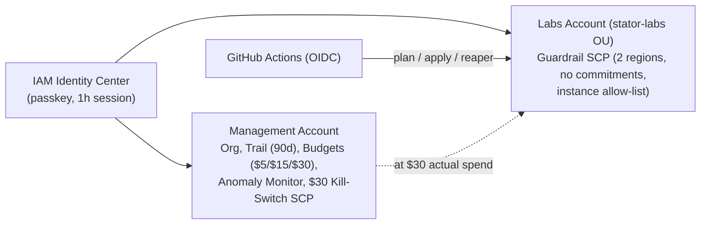

# Lab 00 · Account Foundation

## Architecture

## Proof
- **PR plan comment:** [PR #13](https://github.com/yaaf-some/cloud-project/pull/13#issuecomment-7017659792) (`2 to add, 0 to change, 0 to destroy`).
- **Approved OIDC apply:** [run 44585735716](https://github.com/yaaf-some/cloud-project/actions/runs/44585735716) waited 12 min on `aws-apply` for Yaaf, then signed in as `runway-apply` via OIDC (`2 added`).
- **Budgets & kill switch:** budgets created in [PR #9 run](https://github.com/yaaf-some/cloud-project/actions/runs/44581039403/attempts/1), migrated to [platform/infra/foundation](../../platform/infra/foundation/) in PR #18 ([run 44944710382](https://github.com/stator-labs/stator/actions/runs/44944710382), 0 destroyed), and applied by Yaaf on 2026-11-21: `make plan` shows zero drift, `runway-labs-kill-switch` is `STANDBY`, SCP targets `[]`, MTD spend `$0.046`.
- **Nightly reaper (dry run):** created in [run 44703993484](https://github.com/yaaf-some/cloud-project/actions/runs/44703993484); first OIDC dry run passed in [run 44704490487](https://github.com/yaaf-some/cloud-project/actions/runs/44704490487).
- **Org guardrails (2026-11-20):** `foundation/` applied (`1 imported, 24 added, 1 changed, 0 destroyed`). In labs, `ec2 describe-instances` succeeded in `us-west-2` and failed with `explicit deny in a service control policy` in `eu-west-1` and on `RoleManager/Enabled=true`.
- **Mocked OpenTofu tests (no AWS creds):** `tofu test` passes [2 Lab 00 tests](infra/tests/account-foundation.tftest.hcl) and [20 foundation tests](../../platform/infra/foundation/tests/foundation.tftest.hcl) in CI on every PR (verified via mutation breaks).
- **Still open (keeps Lab 00 🔨):** real reaper deletion with 6-hour age check, `make nuke` (arrives with Lab 03), and kill-switch game day (`STAT-36` Step D).

## Problem
Without guardrails, nobody knows what AWS costs, static keys sit on laptops, and teardown is guesswork. Every lab needs a floor first: spend caps, keyless CI, remote state and clean teardown.

## What I built
- ✅ **AWS Organization & guardrails (`STAT-33`):** `runway-labs` account in `stator-labs` OU, guardrail SCP (2 regions, no commitments, instance allow-list, no org exit, no IAM role manager), 90-day org CloudTrail, IAM Access Analyzer, root sign-in email ([platform/infra/foundation](../../platform/infra/foundation/)).
- ✅ **Human SSO (`STAT-33`):** IAM Identity Center (`yaaf` + passkey, 1-hour `runway-admin` sessions). Legacy IAM user `yaaf-admin` deleted 2026-11-20.
- ✅ **Budgets, anomaly monitor & $30 kill switch (`STAT-9`, `STAT-36`):** monthly budgets at $5 / $15 / $30 (forecast on $30), daily $1 anomaly email, and automatic $30 labs kill-switch SCP in `foundation/`.
- ✅ **OpenTofu OIDC pipeline (`STAT-11`):** remote S3 state with native lockfile, SHA-pinned CI workflows, Checkov tag gate (`CKV_RUNWAY_1`), plan comments on PRs and `aws-apply` approval on `main`.
- 🔨 **Nightly reaper (`STAT-13`):** dry-run role (`tag:GetResources`) runs nightly at 03:17 UTC ([reaper.yml](../../.github/workflows/reaper.yml)). Delete rights and `make nuke` arrive with the first ephemeral stack (Lab 03).

## Cost receipt
| Spent | Idle | Teardown |
|---|---|---|
| `$0.046` MTD (as of 2026-11-21) | Cents/month for org CloudTrail S3 storage. Budgets, Anomaly Detection, SCPs, Identity Center, IAM and public GitHub Actions are `$0`. | `tofu destroy` per stack (`foundation/` keeps `prevent_destroy` on org, labs account and trail) |

## Decisions
**Why OpenTofu over Terraform?** MPL 2.0 open source under the Linux Foundation, native S3 lockfile (no DynamoDB table), identical provider ecosystem.

**Why PowerUser + permissions boundary for `apply`?** Labs touch many services; a hand-maintained allow-list breaks on every new lab. Instead, `apply` gets PowerUser plus IAM writes restricted to `/runway/` roles carrying `runway-boundary`, with explicit denies protecting the pipeline, OIDC provider and state bucket.

**Why immutable ID-based OIDC subjects?** GitHub's `repo:<owner>@<id>/<repo>@<id>:<context>` survives renames and stops repo-name squatting from assuming AWS roles. `bootstrap.sh` reads the prefix directly from GitHub's API.

**Why a custom anomaly monitor?** AWS auto-creates `Default-Services-Monitor` and blocks a second services monitor (`Limit exceeded`). A custom `LINKED_ACCOUNT` monitor avoids importing AWS-owned resources while watching both management and labs accounts.

**Why DAILY anomaly email instead of IMMEDIATE?** AWS restricts `IMMEDIATE` to SNS topics. `DAILY` email keeps the stack simple while the $5 budget catches fast spikes.

**Why does `reaper` trust `main`, not `aws-apply`?** It runs unattended at 03:17 UTC and only reads tags. Delete permissions will require their own approval gate.

## What broke
- First sign-in used root; replaced with Identity Center + passkey (`STAT-10`, `STAT-33`).
- `sso-admin create-instance` fails in an org management account; account-level Identity Center rejects `create-permission-set`. Fixed by enabling the org instance in `us-east-1` Console.
- First apply failed with `Limit exceeded on dimensional spend monitor creation` because AWS already had a default services monitor. Switched to a custom account monitor.
- First CI plan failed `AssumeRoleWithWebIdentity` because immutable OIDC `sub` claims include numeric IDs. Added `tools/oidc-claims.py` to print live claims on failure.
- Missing `ProductAttributes` key in the anomaly monitor JSON forced replacement on every plan; spelling out all 7 keys fixed drift.
- `tofu test` 1.13.9 crashed when an `import` block was present; removed the one-time org import block after apply.
- Three manual test budgets (`runway-monthly-*`) duplicated the stack's budgets; deleted manually on Nov 19.
- IAM admin initially lacked Billing/Cost Explorer console access until enabled once from root.

## What I'd change
- Enable Billing/Cost Explorer access and inspect `aws ce get-anomaly-monitors` before the first apply.
- Cancel superseded `aws-apply` runs automatically so old deployments never sit waiting for days.

**Target roles:** SA, Platform, Cloud, SRE, Security
