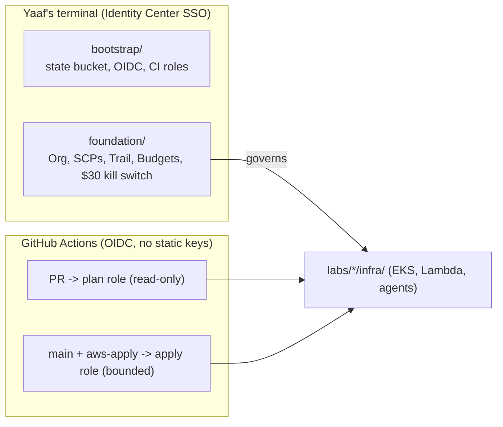

# platform/infra

OpenTofu stacks. GitHub Actions plans every PR and applies on `main` ([infrastructure.yml](../../.github/workflows/infrastructure.yml)). Only `bootstrap/` and `foundation/` run from Yaaf's terminal.



## Layout
- **One folder per stack:** `platform/infra/<stack>/` or `labs/<lab>/infra/`.
- **`bootstrap/`** (terminal-only, management): the management state bucket only. No OIDC provider and no CI role: SCPs do not apply to the management account, so nothing there is CI-reachable.
- **`labs-bootstrap/`** (terminal-only, labs account): `stator-tfstate-<account>` bucket, GitHub OIDC provider, `stator-boundary`, and the CI roles. Legacy roles under `/stator/`: `stator-plan` (PRs, pinned to `tofu-plan.yml`), `stator-apply`, `stator-reaper`. IaC platform v2 roles from [`modules/ci-roles`](modules/ci-roles/README.md) under `/stator/platform/`: `stator-ci-plan-pr`, `stator-ci-plan-main`, `stator-ci-apply`, `stator-ci-reaper`, unused until pipeline v2. Run with `AWS_PROFILE=stator-labs make bootstrap`, then `make cutover`.
- **`foundation/`** (terminal-only): AWS Organization, `runway-labs` account in `stator-labs` OU, guardrail SCP, centralized root access, 90-day org CloudTrail, IAM Access Analyzer, root sign-in alert, Identity Center, budgets ($5/$15/$30), anomaly monitor and the $30 labs kill-switch SCP (`kill-switch.tf`). Personal values live in git-ignored `foundation.auto.tfvars`.
- **`modules/`**: shared modules. Changing them plans every stack.

## Stack rules
- **State:** S3 backend, key `<state_key or id>/terraform.tfstate` from [`platform/stacks.json`](../stacks.json), `use_lockfile = true`. CI passes `-backend-config=bucket=$TF_STATE_BUCKET` so no account ID sits in git. Checked by `tools/tofu-stacks.py check`.
- **Tags:** every `provider "aws"` sets `default_tags` (`project`, `lab`, `runway:ephemeral`). Checked by Checkov `CKV_RUNWAY_1` ([tools/checkov](../../tools/checkov/)).
- **IAM:** roles and policies live under `/runway/` (`/stator/` after Step B) and attach `permissions_boundary`.
- **OIDC roles:** declare `variable "github_sub_prefix"` (no default). Only terminal-only stacks hold OIDC roles, so the bootstrap scripts pass it and CI never does.
- **Providers:** CI plans only stacks whose lockfile lists allowed providers (`aws`, `random`, `tls`). `tools/provider-allowlist.py` runs from `main` before `tofu init`, because plan runs provider code with AWS credentials.
- **Secrets:** CI jobs that plan get no secrets. A PR plan runs the PR's code, so it can read anything passed to it.
- **Lock file:** commit `.terraform.lock.hcl` (`linux_amd64` + `darwin_arm64`). CI runs `-lockfile=readonly`.

## Add a stack
1. List it in [`platform/stacks.json`](../stacks.json): `dir`, `account` (`labs`), `ci: true`, `floor` (`auto` or `manual`). `tofu-stacks.py check` fails on an unlisted stack. Until the entry is on `main`, the gate sends the stack's plans to `manual`.
2. Add `versions.tf` (update `key` and `lab`):
   ```hcl
   terraform {
     required_version = "~> 1.13"
     required_providers {
       aws = { source = "hashicorp/aws", version = "~> 6.73" }
     }
     backend "s3" {
       key          = "03-ephemeral-eks/terraform.tfstate"
       region       = "us-west-2"
       encrypt      = true
       use_lockfile = true
     }
   }

   provider "aws" {
     region = "us-west-2"
     default_tags {
       tags = { project = "runway", lab = "03", "runway:ephemeral" = "true" }
     }
   }
   ```
3. Lock providers: `tofu init -backend=false && tofu providers lock -platform=linux_amd64 -platform=darwin_arm64`.
4. Open a PR for the plan comment; merge and approve `aws-apply`.

To delete a stack: merge a PR emptying its `.tf` resources first, then a PR deleting the folder.

## Terminal-only runbooks (Yaaf)

### Apply `foundation/` (initial setup)
1. Enable IAM Identity Center (org instance) in `us-east-1` via Console.
2. Check `aws organizations list-aws-service-access-for-organization`; ensure every listed service is in `service_access_principals`.
3. Turn off IAM role manager in management: `aws iam put-account-properties --properties RoleManager/Enabled=false`.
4. `make plan` and `make apply` build `foundation.auto.tfvars` from live AWS values when it is missing. `FORCE=1 make tfvars` rebuilds it.
5. Run `make plan` (expect additions only, no destroys) then `make apply`. Confirm the SNS email and delete any legacy IAM admin user.

### Verify the budget kill switch (applied 2026-11-21)
```bash
aws budgets describe-budget-actions-for-budget \
  --account-id "$(aws sts get-caller-identity --query Account --output text)" \
  --budget-name runway-labs-kill-switch --query 'Actions[].Status'
# Expected: ["STANDBY"]
```
Game day (`STAT-36` Step D): attach and detach `runway-labs-deny-new-spend` by hand and log the result in `labs/00-account-foundation/README.md`.

## Decisions
**Why is `foundation/` terminal-only?** It controls the organization, SCPs and human sign-in. Giving CI those rights would let one PR rewrite its own guardrails.

**Why import the organization instead of creating it?** It already existed with centralized root access enabled. Importing brought it under code without recreation; the temporary `import` block was removed after apply so `tofu test` runs cleanly.

**Why do budgets and the kill switch live in `foundation/`?** Only the management account sees org-wide spend and can attach SCPs. Once CI moves to the labs account (`STAT-36`), CI cannot manage management budgets or attach SCPs.
